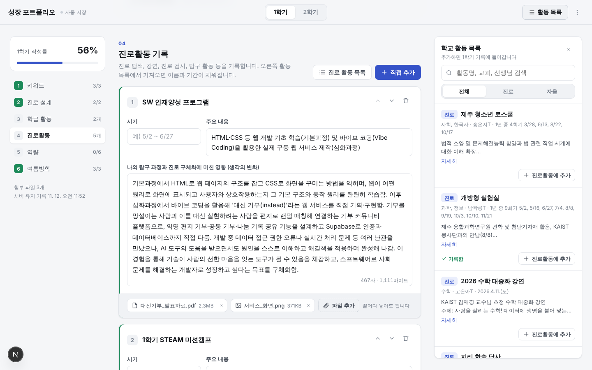
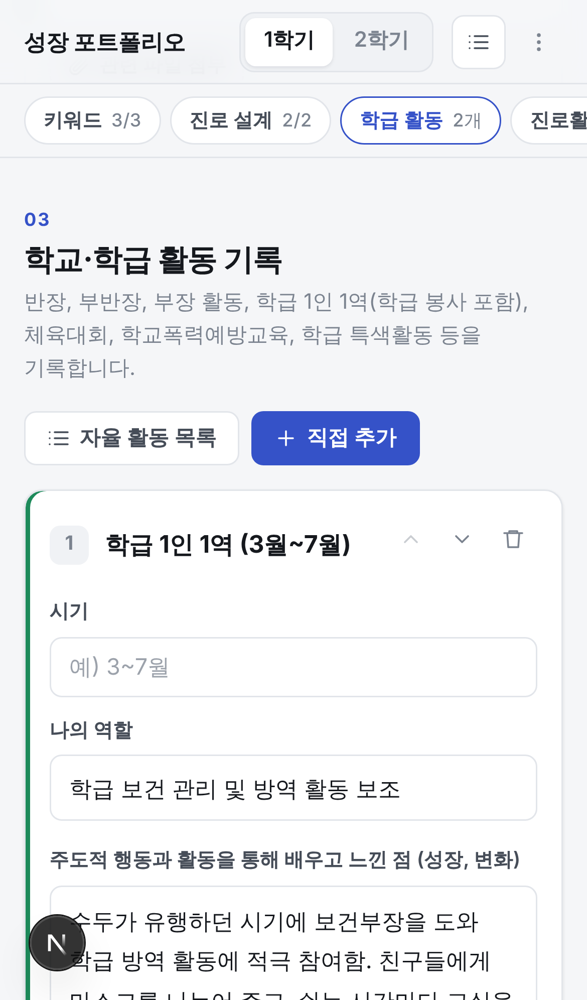

# 성장 포트폴리오

생활기록부 작성용 엑셀 양식(성장 포트폴리오)을 웹으로 옮긴 개인용 사이트입니다.

- 1학기 / 2학기 전환, 섹션별 작성률 표시
- 답변 카드마다 관련 파일 첨부 (이미지, PDF 미리보기)
- 학교 진로·자율 활동 목록에서 검색해 바로 가져오기
- 쓰는 즉시 자동 저장, 글자 수와 나이스 기준 바이트 표시
- 원본 양식 엑셀에서 기존 내용 불러오기
- 비밀번호 로그인 (본인 한 명만 사용)
- Supabase 무료 플랜 일시 정지 방지 (매일 자동 기록)

| 컴퓨터 | 휴대폰 |
|---|---|
|  |  |

## 구성

- Next.js 15 (Vercel 배포)
- Supabase: 로그인, 답변 저장(`entries`), 첨부 파일 목록(`attachments`), 비공개 파일 저장소(`attachments` 버킷)
- Vercel Cron: 매일 1번 `/api/keepalive` 호출

## 설치 순서

### 1. Supabase

1. [supabase.com](https://supabase.com)에서 새 프로젝트를 만듭니다. 지역은 `Northeast Asia (Seoul)`을 고르면 빠릅니다.
2. 왼쪽 메뉴 **SQL Editor**에서 `supabase/schema.sql` 내용을 전부 붙여넣고 **Run**을 누릅니다.
3. **Authentication > Users > Add user > Create new user**
   - 이메일: 아무 이메일 (로그인 화면에는 안 보입니다)
   - 비밀번호: 사이트에 들어갈 때 쓸 비밀번호
   - **Auto Confirm User**를 켭니다.
4. **Authentication > Sign In / Providers**에서 **Allow new users to sign up**을 끕니다. 다른 사람이 계정을 만들 수 없게 하는 중요한 설정입니다.
5. **Project Settings > API Keys**에서 Project URL과 publishable(anon) key를 복사해 둡니다.

### 2. Vercel

1. 이 저장소를 GitHub에 올립니다. 개인 기록이 들어가므로 **비공개(Private) 저장소**로 만드세요.
2. [vercel.com](https://vercel.com)에서 **Add New > Project**로 저장소를 가져옵니다.
3. **Environment Variables**에 아래 4개를 넣고 Deploy 합니다.

| 이름 | 값 |
|---|---|
| `NEXT_PUBLIC_SUPABASE_URL` | Supabase Project URL |
| `NEXT_PUBLIC_SUPABASE_ANON_KEY` | Supabase publishable(anon) key |
| `OWNER_EMAIL` | 1-3에서 만든 사용자 이메일 |
| `CRON_SECRET` | 아무 긴 무작위 문자열 (예: 비밀번호 생성기로 32자) |

4. 배포된 주소로 들어가서 비밀번호로 로그인합니다.
5. 처음에는 화면 위쪽의 **엑셀에서 불러오기**로 기존 엑셀 파일을 올리면 1학기 내용이 채워집니다.

### 3. 일시 정지 방지 확인

Supabase 무료 플랜은 **7일 동안 활동이 거의 없으면 프로젝트를 일시 정지**합니다 (정지 후 90일 안에는 대시보드에서 복구 가능).
이를 막으려고 Vercel Cron이 매일 한 번(UTC 03:17, 한국 시간 12시대) `/api/keepalive`를 호출해 `keepalive` 테이블에 기록을 남깁니다.

- Vercel 무료(Hobby) 플랜의 Cron은 하루 1번이 한도이고, 정해진 시각에서 최대 1시간 안에 실행됩니다.
- Vercel 프로젝트 **Settings > Cron Jobs**에서 **Run**을 눌러 바로 실행해 볼 수 있습니다.
- 사이트 왼쪽 목차 아래 **서버 유지 기록**에 마지막 실행 시각이 표시됩니다. 며칠째 그대로라면 Cron 설정과 `CRON_SECRET`을 확인하세요.

## 비밀번호 바꾸기

Supabase **SQL Editor**에서 실행합니다. 따옴표 안을 바꿔 넣으세요.

```sql
update auth.users
set encrypted_password = extensions.crypt('새 비밀번호', extensions.gen_salt('bf'))
where email = '로그인 이메일';
```

사용자를 지웠다가 다시 만들면 기존 기록과 연결이 끊어지므로, 지우지 말고 위 방법으로 바꾸세요. (실수로 지워지지 않도록 기록이 있는 사용자는 삭제가 막혀 있습니다.)

## 로컬에서 실행

```bash
cp .env.example .env.local   # 값 채우기
npm install
npm run dev
```

## 데이터 구조

모든 답변은 `entries` 테이블에 `key`와 JSON `value`로 저장됩니다. 키 규칙은 `lib/schema.ts` 맨 위에 정리되어 있습니다.
첨부 파일은 `attachments` 버킷의 `<사용자 id>/` 폴더에 저장되고, 원래 파일 이름과 어느 답변에 붙었는지는 `attachments` 테이블에 기록됩니다.
